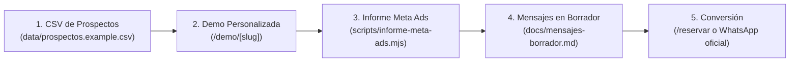

# Mecanismo de Enganche Comercial — Atento

> **Regla de oro:** **No se envía nada desde este repositorio.** Todos los mensajes (`docs/mensajes-borrador.md`) son borradores y cualquier envío real requiere el **OK explícito de Silvio**.

Este documento describe el flujo extremo a extremo para captar las **3 primeras clínicas del Programa Fundadores** combinando personalización inmediata y transparencia técnica.

---

## Flujo de extremo a extremo



---

## Paso 1: Registro en CSV (`data/prospectos.example.csv`)

Cada fila representa una clínica prospecto con 17 columnas:

- **Identificación y contacto público:** `nombre`, `ciudad`, `pais`, `nicho`, `web`, `telefono_o_whatsapp_publico`, `email_publico`.
- **Señales comerciales:** `rating`, `cantidad_resenas`, `chat_o_reservas_online`, `anuncios_en_meta`, `puntaje`, `motivo`, `fuente`.
- **Configuración de demo:**
  - `slug`: identificador URL amigable (ej. `clinica-estetica-luna-demo`).
  - `servicios`: lista separada por punto y coma `;` (ej. `"limpieza facial;botox;acido hialuronico;laser"`).
  - `ficticio`: `si` o `no`. Si es `si`, la demo muestra explícitamente el aviso **«datos ficticios»**.

---

## Paso 2: Demo personalizada (`/demo/[slug]`)

La ruta `src/app/demo/[slug]/page.tsx` lee el CSV en servidor (`src/lib/prospectos.ts`) y genera estáticamente (`generateStaticParams`) una página para cada `slug` válido (`notFound()` si el slug no existe).

### Garantías de la demo personalizada
1. **Personalización real:** el recepcionista IA (`createClinicBot` + `prospectoToConfig` en `src/lib/chatBot.ts`) saluda con el **nombre**, la **ciudad** y los **servicios** de esa clínica.
2. **Transparencia IA y DEMO:** incluye banda superior fija y primer mensaje del chat indicando claramente que es una **DEMO** atendida por una **Inteligencia Artificial (IA)** y no una persona.
3. **Sin precios inventados:** los tratamientos cargados desde el CSV muestran `Precio a confirmar por la clínica (demo)`.
4. **Etiqueta de datos ficticios:** cuando `ficticio=si`, tanto la cabecera como el saludo muestran `datos ficticios`.
5. **Demo original intacta:** la ruta `/demo` conserva la demostración general de «Clínica Dental Aurora».

### Rutas generadas por defecto
- `/demo/clinica-estetica-luna-demo` (Clínica Estética Luna Demo · Madrid)
- `/demo/dental-sonrisa-norte-demo` (Dental Sonrisa Norte Demo · Madrid)

---

## Paso 3: Informe de competencia de 1 página (`scripts/informe-meta-ads.mjs`)

Antes o durante la llamada de diagnóstico, generamos un informe en Markdown de una página sobre los anuncios activos del nicho en la ciudad de la clínica:

```bash
node scripts/informe-meta-ads.mjs \
  --query "clinica estetica madrid" \
  --country ES \
  --input scripts/fixtures/meta-ads-ejemplo.json \
  --out docs/informes/clinica-estetica-madrid.md
```

- **Fuentes en orden de prioridad:** `--input` → lectura en vivo (solo si existe `META_AD_LIBRARY_TOKEN`) → fallback automático a `scripts/fixtures/meta-ads-ejemplo.json` (marcado como **FIXTURE**).
- **Resumen opcional con modelo barato:** si se define `FREELLM_URL`, resume únicamente los textos obtenidos; si no, aplica una plantilla fija determinista.
- **Cero métricas inventadas:** CPC, CTR, presupuesto y conversiones figuran siempre como **`no disponible`**.
- **Zona horaria:** fecha estampada en `Asia/Taipei`.

Ver detalles completos en [`scripts/README-informe-meta-ads.md`](../scripts/README-informe-meta-ads.md).

---

## Paso 4: Secuencia de mensajes en borrador (`docs/mensajes-borrador.md`)

En [`docs/mensajes-borrador.md`](./mensajes-borrador.md) se incluyen las plantillas en estado **BORRADOR (NO ENVIAR)**:
- **3 correos B2B** (Día 0, Día 3, Día 7).
- **3 mensajes de WhatsApp** (Día 0, Día 3, Día 7).

### Tabla de enganche (`motivo` del CSV → gancho del Mensaje 1)

| Slug en CSV | `motivo` detectado | Gancho personalizado para el primer mensaje |
| :--- | :--- | :--- |
| `clinica-estetica-luna-demo` | `Anuncia en Meta y responde lento por WhatsApp` | «Vimos que invierten en anuncios en Meta para estética facial en Madrid y preparamos una demo IA que responde en segundos por WhatsApp fuera de horario.» |
| `dental-sonrisa-norte-demo` | `Buenas resenas sin chatbot 24/7` | «Tienen excelentes reseñas en Madrid pero solo formulario web; armamos una demo IA 24/7 con sus servicios de estética dental y ortodoncia invisible.» |

---

## Paso 5: Reserva de llamada (`/reservar`) y WhatsApp oficial

Tanto las demos personalizadas como los borradores dirigen al prospecto a dos vías de contacto:

1. **Página `/reservar` (`src/app/reservar/page.tsx`):**
   - Enlace al calendario provisional (`https://cal.com/atento-placeholder`, etiquetado como placeholder).
   - Enlace directo al WhatsApp oficial de Atento.
   - Formulario local client-side (`src/components/ReservaForm.tsx`) que muestra confirmación en el navegador sin enviar datos a servidores ni bases de datos.
2. **Canal WhatsApp oficial de Atento:**
   - **Enlace:** https://wa.me/886979516713
   - **Número:** `+886 979 516 713`

---

## Cumplimiento RGPD / LSSI y Reglas Operativas

- **Solo datos públicos profesionales B2B:** contactar únicamente a canales corporativos publicados por la propia clínica en su web o ficha pública.
- **Identificación y transparencia:** identificarse desde la primera línea como **Silvio · Atento (agencia de IA)** y avisar que la demo es un sistema de Inteligencia Artificial.
- **Baja inmediata:** incluir siempre la opción de responder `BAJA` o enlace de baja en cada mensaje y respetar cualquier oposición de forma definitiva.
- **Cero automatización de envíos:** este repositorio no contiene ni ejecutará scripts de envío de emails ni de mensajes de WhatsApp.
